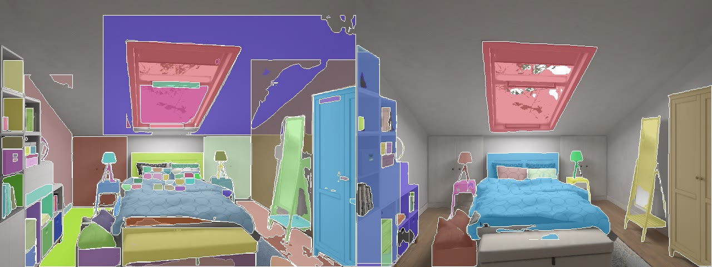

# ObjectSAM



**사진 속 물체는 이름을 몰라도 모두 자르고, 벽·천장·바닥은 자르지 않는 로봇용 분할 모델.** (왼쪽 FastSAM-s, 오른쪽 ObjectSAM, 확신도 0.4)

- **구조물은 배경이다.** 벽·천장·바닥(바깥의 도로·잔디 같은 땅 포함)·하늘에는 마스크를 내지 않는다. 그래서 FastSAM 처럼 구조물 마스크를 골라 지우는 후처리가 필요 없다.
- **문·창·계단은 물체다.** 카펫·러그도 물체로 둔다.
- **클래스 목록이 없다.** 모든 마스크가 `object` 하나다. 이름이 필요하면 마스크 조각에 CLIP/SigLIP 등을 붙인다.
- **FastSAM-s 와 같은 신경망이다.** YOLOv8s-seg, 클래스 1 개, 파라미터 1,180 만 개(0.012B)라 크기·속도가 FastSAM-s 와 같고, 출력 모양도 같아 FastSAM 후처리를 그대로 쓴다.

## 어떻게 만들었나

큰 선생 모델이 라벨을 만들고, 작은 학생 모델이 그 라벨을 배운다(지식 증류).

| 단계 | 내용 | 자세히 |
|---|---|---|
| ① 선생 | **CropFormer Hornet-L**(0.22B, 개체 분할). COCO train2017 사진 118,287 장 모두에 돌려 마스크를 만든다. 원본 PyTorch 를 C++/CUDA fp16 으로 옮겨 한 장 약 0.24 초. | [docs/TEACHER.md](docs/TEACHER.md) |
| ② 라벨 고르기 | 선생 마스크 중 구조물을 뺀다. COCO panoptic 사람 라벨이 배경(벽·천장·바닥·하늘·건물 22 종)이라 하고, 애매하면 SigLIP2 도 구조물이라 할 때만 뺀다. 구조물과 물체가 한 마스크로 섞인 경우는 COCO 라벨로 나눈다. | [docs/LABELS.md](docs/LABELS.md) |
| ③ 학생 | **YOLOv8s-seg**(1 클래스, 입력 640). COCO 로 학습된 yolov8s-seg 에서 출발. 직접 짠 C++/CUDA 학습기 `build/train` 으로 학습(CUDA graph, cuDNN, 증강도 GPU). | [docs/SPEC.md](docs/SPEC.md), [docs/FASTSAM_NETWORK.md](docs/FASTSAM_NETWORK.md) |

학습 데이터는 **COCO train2017 사진과 CropFormer 라벨뿐**이다(COCO 사람 라벨은 구조물 판정에만 쓴다). 평가 데이터 uHumans2 는 어떤 형태로도 학습에 쓰지 않는다.

증강은 Ultralytics 와 같다(모자이크, 크기 0.5~1.5 배, 위치 ±10 %, 좌우 뒤집기, HSV). 실험으로 더한 것 두 가지: 벽·바닥이 보이는 실내 사진(전체의 47 %)을 2 배로 뽑고, 마지막 1 epoch 는 모자이크를 끈다.

## 결과: uHumans2 (학습 분포 밖)

시험은 [Meridian](https://github.com/neoul-ro/meridian_benchmark) frontend 벤치마크로 했다. 대상은 uHumans2 의 apartment_00h·01h·02h·office_00h·12h 5 시퀀스 합계다.
- 바꾼 것은 SAM 엔진(1024 TensorRT)과 확신도 문턱뿐이다.
- 채점(S3)은 물체 GT 만 센다. 벽·천장·바닥 GT 는 무시 영역으로 둔다.
- 구조물예측%·구조물화소% 는 마스크가 구조물 위에 놓인 비율이다.

최종 모델 **ObjectSAM v21L**(100 epoch):

| 모델 | P ↑ | R ↑ | F1 ↑ | PQ ↑ | 과다분할 ↓ | 과소분할 ↓ | 트랙 재현율 ↑ | IDF1 ↑ | HOTA ↑ | mIoU ↑ | 구조물예측% ↓ | 구조물화소% ↓ |
|---|---|---|---|---|---|---|---|---|---|---|---|---|
| FastSAM-s @0.4 | 48.7 | 68.1 | 56.8 | 0.471 | 449 | **613** | 88.3 | 0.424 | 0.485 | 0.620 | 56.6 | 69.2 |
| FastSAM-s @0.1 | 39.8 | **78.8** | 52.9 | 0.439 | 453 | 862 | **93.8** | 0.369 | 0.442 | **0.707** | 61.3 | 72.2 |
| **ObjectSAM v21L @0.4** | **78.1** | 58.0 | **66.6** | **0.569** | **145** | 1102 | 79.6 | **0.525** | **0.540** | 0.548 | **13.9** | **28.0** |
| ObjectSAM v21L @0.1 | 57.6 | 73.2 | 64.5 | 0.545 | 269 | 1388 | 91.7 | 0.457 | 0.518 | 0.677 | 29.3 | 45.7 |

- **ObjectSAM 이 이기는 칸**(두 문턱 모두, FastSAM-s 두 문턱 중 좋은 값보다): 12 칸 중 **8 칸**. 정밀도·F1·PQ·IDF1·HOTA 가 오르고, 과다분할과 구조물 마스크는 크게 준다.
- **지는 칸**: 재현율·mIoU·트랙 재현율·과소분할. uHumans2 GT 는 가구를 부품 단위로 나눈다. 침대 하나가 GT 10 개, 선반은 칸마다, 의자는 판과 다리가 따로다. 그래서 물체를 통째로 자르면 '묶어서 잘랐다'(과소분할)로 세지고, 그만큼 재현율도 깎인다.
- 실험 과정(v1~v31, 가설·결과·버린 방향)과 모든 표는 [docs/BENCHMARK.md](docs/BENCHMARK.md)에 있다.

## 저장소 구성

| 경로 | 내용 |
|---|---|
| `src/` | 학습기 `build/train`: YOLOv8s-seg 순전파·역전파, 손실, 옵티마이저, GPU 증강, 데이터 읽기 |
| `teacher/` | CropFormer Hornet-L C++/CUDA 구현과 라벨 도구 `build/teacher_label` |
| `tests/` | PyTorch 와의 정합성 검사(`parity`, `teacher_parity`), 증강 덤프, 학습 속도 측정 |
| `pytools/` | 라벨 판정(`label_plan.py`, `siglip_*_judge.py`), 가중치 변환(`fsow_to_pt.py`, `dump_weights.py`), 분석·그림 도구 |
| `scripts/` | 데이터 받기, 선생 환경, 실험 한 바퀴(`exp.sh`), 최종 학습(`long_v21.sh`) |
| `analysis/` | 오류 분석 리포트와 스크립트 |
| `docs/` | 스펙·선생·라벨 규칙·벤치마크 기록 |
| `archive/` | **예전 ObjectSAM**(YOLO26n-seg, FastSAM-s 에서 증류, 416 입력, v1.0 릴리스). 지금 모델과 다른 설정이다. |

## 다시 만들기

RTX 5070 Ti(sm_120), CUDA 12.8 기준이다. 다른 GPU 는 `CMakeLists.txt` 의 `CMAKE_CUDA_ARCHITECTURES` 를 바꾼다.

```bash
# 1. 빌드
cmake -B build -DCMAKE_BUILD_TYPE=Release && cmake --build build -j

# 2. 데이터: COCO 2017 사진·정답
scripts/download_coco.sh

# 3. 선생 라벨 (가중치 변환용 PyTorch 환경은 scripts/setup_teacher.sh, docs/TEACHER.md '다시 만들기')
#    가중치 기본값 weights/teacher/cropformer_hornet_l.fsow
build/teacher_label --list data/teacher/train2017.list --out data/teacher/train2017.ftl

# 4. 라벨 판정: 구조물 빼기·나누기 → SigLIP2 판정
.venv/bin/python pytools/label_plan.py                # → data/teacher/train2017.plan
.venv-teacher/bin/python pytools/siglip_b32_judge.py  # → data/teacher/train2017.siglip (TensorRT 엔진 필요, 파일 머리말)

# 5. 학습: 최종 모델(v21L)의 처방. 5 epoch 학습(v21) 뒤 100 epoch 까지 이어서
scripts/long_v21.sh

# 6. Ultralytics .pt 로 변환 → ONNX/TensorRT 는 Ultralytics 그대로
.venv/bin/python pytools/fsow_to_pt.py runs/v21L/ema_last.fsow objectsam.pt
```

변환한 `.pt` 는 FastSAM-s 와 같은 방식으로 쓴다.

```python
from ultralytics import YOLO
r = YOLO("objectsam.pt")("room.jpg", imgsz=640, conf=0.4, retina_masks=True)[0]
masks = r.masks.data   # (N, H, W) 물체마다 마스크 하나
```

학습한 가중치는 아직 이 저장소에 올리지 않았다.

## 라이선스

- 코드는 AGPL-3.0([LICENSE](LICENSE))이다. 신경망 구조는 Ultralytics YOLOv8 / FastSAM 을 따른다.
- 선생 CropFormer 의 코드·가중치는 CC BY-NC 4.0 이다. 그래서 이 라벨로 학습한 모델은 **비상업 연구용**이다.
- 자세한 출처는 [NOTICE](NOTICE)에 있다.
